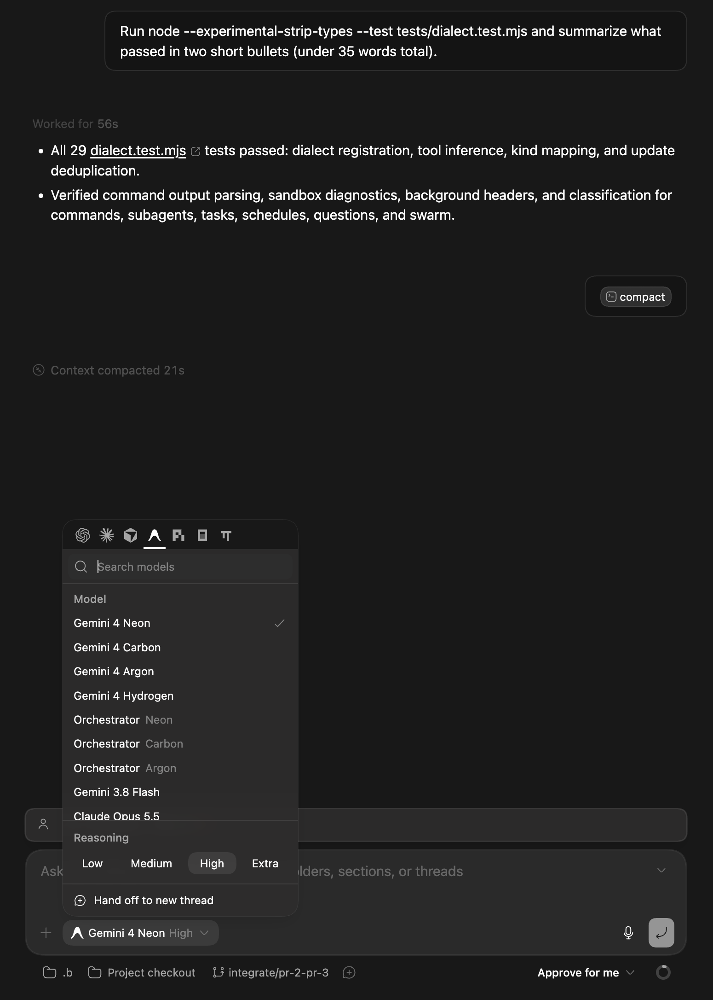
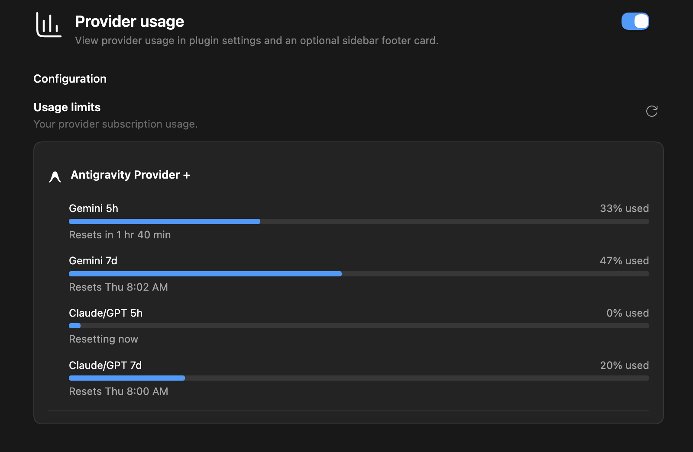

<p align="center">
  
</p>

<h1 align="center">Antigravity Provider +</h1>

<p align="center">
  Use Google Antigravity CLI in BB with built-in 5h and 7d quota tracking, reload-safe instructions, thread forking, manual <code>/compact</code>, per-model reasoning, and a live <code>/swarm</code> board.
</p>

<p align="center">
  <a href="https://github.com/tymshe/bb-plugin-antigravity-plus/actions/workflows/checks.yml"></a>
  <a href="https://github.com/tymshe/bb-plugin-antigravity-plus/releases/latest"></a>
  <a href="LICENSE"></a>
</p>

<p align="center">
  <a href="#quick-install">Quick install</a> &middot;
  <a href="#screenshots">Screenshots</a> &middot;
  <a href="#why-use-this-instead-of-bbs-built-in-acp">Comparison</a> &middot;
  <a href="#what-you-get">What you get</a> &middot;
  <a href="#modes-permissions-and-settings">Settings</a> &middot;
  <a href="docs/FEATURES.md">Capabilities</a> &middot;
  <a href="SECURITY.md">Security</a>
</p>

---

**Antigravity Provider +** (`antigravity-plus`) runs on your existing [Antigravity CLI](https://antigravity.google/docs/getting-started?tab=cli) (`agy`) subscription and login, adding native BB workflow controls and built-in quota tracking beyond a manual ACP setup. No extra API keys or custom ACP JSON required.

Verified on macOS (`agy 1.5.16`, BB Desktop), Linux (`agy 1.5.14`), and Windows (`agy 1.5.1+`). Installs side by side under `antigravity-plus` without touching existing Antigravity threads.

## Quick install

```sh
bb plugin install antigravity-plus
```

Requires BB `0.50+`, Node.js `22+`, and Antigravity CLI `1.5.0+` (`1.5.14+` for `/compact`) signed in on the target host (`agy acp --login`). See [Getting started](#getting-started) for full setup and remote hosts.

## Screenshots

<p align="center">
  
  <br>
  <sub>Active Antigravity thread with native <code>/compact</code> status, live model and reasoning picker, <strong>Build</strong> mode, and <strong>Accept Edits</strong>.</sub>
</p>

<table>
  <tr>
    <td align="center" width="33%">
      <a href="assets/screenshots/usage.png"></a>
      <br><sub><strong>5h and 7d quota tracking</strong></sub>
    </td>
    <td align="center" width="33%">
      <a href="assets/screenshots/swarm-board.png"></a>
      <br><sub><strong>Live <code>/swarm</code> board and pill</strong></sub>
    </td>
    <td align="center" width="33%">
      <a href="assets/screenshots/settings.png"></a>
      <br><sub><strong>Safety and sandbox settings</strong></sub>
    </td>
  </tr>
</table>

<p align="center"><sub>Click any screenshot to inspect full size.</sub></p>

## Why use this instead of BB's built-in ACP

| Capability | Built-in ACP | Antigravity Provider + |
| :--- | :--- | :--- |
| **Instructions across reloads** | ❌ Lost on reload | ✅ Reapplied on every load and resume |
| **5h and 7d quota tracking** | ❌ Not shown | ✅ Built into BB's Usage dashboard |
| **Thread forking** | ❌ Unavailable | ✅ Fork at latest message (native pass-through when CLI adds it) |
| **Manual and auto `/compact`** | ❌ Unavailable | ✅ Native `/compact` plus **Compacted context** timeline cards |
| **Per-model reasoning** | ⚠️ Coarse subset | ✅ Full model ladder (including `xhigh` and `max` where supported) |
| **Work modes** | ⚠️ Raw ACP modes | ✅ Single **Build** / **Plan** mode selector |
| **Command cards and safety** | ⚠️ Raw shell strings, no escape guard | ✅ Plain-English summaries, **Outside of sandbox** badges, sandbox-only auto-approve |
| **Live `/swarm` board** | ❌ Terminal-only `alt+s` hint | ✅ Native **Swarm** panel tab, composer pill, and readable swarm cards |
| **Background tasks and skills** | ❌ Silent until done | ✅ Live background banners across restarts, BB subagent option, user and workspace skills |
| **CLI install and updates** | ❌ Manual CLI management | ✅ Zero-token sign-in check, **Settings -> Updates**, and one-click Install / Update |
| **Session isolation** | ⚠️ Shared CLI worker | ✅ One worker per thread, custom profiles, macOS BB Desktop fix |

## What you get

### Reload-safe instructions and built-in quota tracking

- **Instructions that survive reloads.** Extracts BB's `<system_instructions>` block into Antigravity's native system prompt channel (`_meta.antigravity.systemPrompt.append`), stores it per session, and reapplies it on every load and resume.
- **Built-in 5-hour and 7-day quota tracking.** Reports `Gemini` and `Claude/GPT` usage windows and reset times directly in BB's Usage dashboard through `provider/usage` and `provider-usage.v1`.

### Live `/swarm` board inside BB

In the terminal CLI, `/swarm` prints a terminal-only `alt+s` hint. Inside BB, Antigravity Provider + renders it natively:

- **Swarm side-panel tab.** Appears only on threads with an active swarm and opens automatically when a swarm starts (`autoOpenSwarmBoard`, on by default). Shows the swarm title, optional coordinator `plan.json` overview, clickable member roster with per-worker models and status, sort toggle, and Markdown posts with `brief`, `done`, and `blocked` badges.
- **Swarm composer pill.** Shows `<title> · N active · M posts` above the composer so you can reopen the Swarm tab in one click.
- **Readable swarm timeline cards.** Formats `swarm` (`title`, `add`, `kill`, `status`, `models`, `model`), `post_message`, `read_board`, and `swarm_wait` calls clearly.
- **Works on local and remote hosts.** Reads `<appData>/brain/<conversationId>/.system_generated/swarm/` read-only over BB's host RPC without mutating `agy` files.

### Thread forking and manual plus auto compaction

- **Tip forking.** Branch any Antigravity thread at its latest message (`fork: "tip"`) via consistent SQLite snapshots (`VACUUM INTO`), UUID rewriting, and `brain/` directory copy, with automatic pass-through if a future CLI release advertises native `session/fork`.
- **Manual and automatic compaction.** Wires BB's Compact action and `bb thread compact` to native `/compact` (`agy 1.5.14+`) with failure detection, and surfaces automatic compactions as **Compacted context** cards in the thread timeline.

### Models, command safety, background tasks, and CLI updates

- **Per-model reasoning and host-level model cache.** Discovers live models (`Gemini`, `Claude`, `GPT-OSS`) once per host (`models.scope: "host"`) and exposes each model's reasoning ladder (`low` through `max` where supported).
- **Readable command cards and sandbox-escape guard.** Displays Antigravity's `toolSummary` as the command title, strips wrapper timestamps, extracts exit codes, flags out-of-sandbox calls with a destructive **Outside of sandbox** badge, and lets you auto-approve routine in-sandbox commands while still prompting on `BypassSandbox` escapes (`acceptEditsApproval`).
- **Live background banners and BB delegation.** Tracks backgrounded commands, timers, and subagents in BB's background task banner across restarts, with an optional `subagentsDisabled` toggle to delegate via visible BB child threads instead.
- **User and workspace skills.** Indexes personal (`.gemini/antigravity-cli/skills`, `.gemini/skills`, `.gemini/config/skills`, `.agents/skills`) and workspace (`.agents/skills`, `.agent/skills`) skill roots in BB's picker while leaving CLI-internal prompts inside `agy`.
- **Built-in CLI install, update checks, and sign-in health.** Detects missing `agy` or versions below `1.5.0`, verifies sign-in without spending tokens, guides signed-out setups to `agy acp --login`, checks for newer CLI releases in **Settings -> Updates**, and wires BB's **Install** and **Update** (`agy update`) actions.
- **Isolated sessions and desktop reliability.** Passes `--process-per-session` automatically, fixes macOS BB Desktop Electron child spawns (`ELECTRON_RUN_AS_NODE=1`), and forwards `BB_ANTIGRAVITY_GEMINI_DIR`, `BB_ANTIGRAVITY_APP_DATA_DIR`, `BB_AGY_ACP_PROXY`, and `AGY_CLI_AUTO_COMPACT_OVERRIDE` (`agy 1.5.15+`).

## Getting started

### 1. Prepare the agent host

Install Antigravity CLI `1.5.0+` (`1.5.14+` recommended for `/compact`) on the machine where threads run, or click **Install** in BB's provider panel after installing the plugin:

- **macOS / Linux:** `curl -fsSL https://antigravity.google/cli/install.sh | bash`
- **Windows (PowerShell):** `irm https://antigravity.google/cli/install.ps1 | iex`

Verify your CLI and sign in:

```sh
agy --version
agy acp --help
agy acp --login
```

The plugin checks `PATH` first, then the default CLI location (`~/.local/bin/agy` on macOS and Linux, `%LOCALAPPDATA%\agy\bin\agy.exe` on Windows). Remote agent hosts need their own `agy` install and login.

### 2. Install the plugin

From the BB Community marketplace:

```sh
bb plugin install antigravity-plus
```

Or directly from GitHub:

```sh
bb plugin install https://github.com/tymshe/bb-plugin-antigravity-plus
```

Review and accept BB's installation prompt. BB plugins run with full trust.

### 3. Start a thread

Pick **Antigravity Provider +** (`antigravity-plus`) in BB's provider selector, choose a model and reasoning effort, and send a prompt. Start a prompt with `/swarm` to run a multi-agent swarm and watch it live in the **Swarm** side-panel tab.

## Modes, permissions, and settings

Work mode and permission mode are independent controls:

| Control | Choice | Behavior |
| :--- | :--- | :--- |
| Work mode | **Build** (default) | Implements the task under native Accept edits behavior and your chosen BB permission mode. |
| Work mode | **Plan** | Selects Antigravity's native Plan mode to research and outline before editing. Plan guides agent behavior and does not enforce read-only access. |
| Permissions | **Accept edits** | Workspace edits run natively. Other ACP prompts follow your `acceptEditsApproval` setting (`Ask for each request` by default). |
| Permissions | **Auto** | Switches the agy session to Antigravity's native Auto mode (agy 1.5.4+), where Antigravity reviews its own tool calls. Requests it still escalates come to you in BB. Plan takes precedence. If the session does not offer Auto, the thread stays in Accept edits and shows a warning once. |
| Permissions | **Full access** | BB's shared ACP bridge auto-approves every ACP permission request, including requests to run outside the CLI sandbox. |

Configure plugin settings under **Settings -> Installed plugins -> Antigravity Provider +**:

| Setting | Default | What it does |
| :--- | :--- | :--- |
| `autoOpenSwarmBoard` | `true` | Opens the **Swarm** tab in the thread side panel once when `/swarm` starts on a thread. |
| `commandDescriptionsEnabled` | `true` | Shows Antigravity's `toolSummary` as the command card title with the raw shell command underneath. |
| `subagentsDisabled` | `false` | Disables Antigravity's built-in subagent tools so agents delegate via visible BB child threads instead. Does not affect `/swarm`. |
| `acceptEditsApproval` | `"ask"` | Controls Accept edits approval prompts on new turns: `ask` (ask for each request), `auto-in-sandbox` (auto-approve in sandbox, still ask on sandbox escape), or `auto-all` (auto-approve all requests). |
| `sandbox` | `false` | Passes `--sandbox` on new threads instead of inheriting your CLI default. |

## Known limits and troubleshooting

See [docs/FEATURES.md](docs/FEATURES.md) for the complete capability table.

- **Mid-thread rewind and message editing** are disabled because `agy acp` does not expose `session/rewind`.
- **Interactive `ask_question` cards** are not yet bridged by BB's shared ACP bridge.
- **Swarm worker permissions in Accept edits mode.** Workers run inside the thread's active workspace. If a worker tries to read or write files outside the workspace in Accept edits mode, its approval prompt cannot route through the coordinator's ACP channel and will time out after 60 seconds. Keep worker targets inside the workspace or run the thread in Full access mode.
- **BB `Auto` permission mode** maps to agy's native Auto session mode; it is available only where agy offers it (agy 1.5.4+, rolled out to the account, OS terminal sandbox). Service tiers and native thread archive or rename sync are not supported.
- **Side-by-side coexistence.** Registers under `antigravity-plus` with its own dialect ID and state directory (`~/.bb/plugin-data/bb-plugin-antigravity-plus`), so it does not collide with other Antigravity plugins.

| Problem | What to check |
| :--- | :--- |
| `agy` is missing or older than `1.5.0` | Click **Install** or **Update** in BB's provider panel, or run `agy update` on the host. |
| Sign-in missing or expired | Run `agy acp --login` on the agent host, then retry. |
| Need to isolate proxy behavior | Set `BB_AGY_ACP_PROXY=0` to connect directly to `agy acp` and compare. |

<details>
<summary><strong>Architecture and development</strong></summary>

### How it works

```text
BB thread -> Antigravity Provider + host -> BB shared ACP bridge -> ACP proxy -> agy acp
                                         \-> Host RPC (readSwarmBoard) -> Swarm panel tab & composer pill
```

The ACP proxy runs inside the plugin's own host module (`ELECTRON_RUN_AS_NODE=1` on Electron hosts). Set `BB_AGY_ACP_PROXY=0` in the host environment (`bb machine env`) to bypass the proxy for troubleshooting. Bypassing the proxy disables native system-prompt lifting, tip forking, and `/compact` failure detection while leaving ordinary ACP chat working.

### Local development checks

Requires Node.js 22.18+ or Node.js 24.

```sh
npm ci --ignore-scripts
bb plugin types --check .
npm run check
npm test
npm run build
npm run check:release
npm run smoke -- --modes
npm pack --dry-run --ignore-scripts
```

</details>

## Credits and license

Licensed under the [MIT License](LICENSE). Independent of Google and BB.

Community fork of [ols-md/bb-plugin-antigravity](https://github.com/ols-md/bb-plugin-antigravity) by `dionis-d`, incorporating upstream community contributions from:

- `AdzeB` ([PR #27](https://github.com/ols-md/bb-plugin-antigravity/pull/27) profile directory env forwarding, [PR #28](https://github.com/ols-md/bb-plugin-antigravity/pull/28) `xhigh` and `max` reasoning levels)
- `mturilin` ([Issue #29](https://github.com/ols-md/bb-plugin-antigravity/issues/29) ACP proxy for native system prompts, tip forking, manual compaction, and outdated CLI diagnostics)
